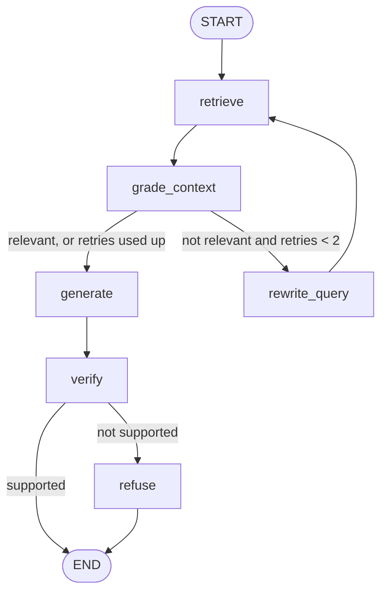

# Learning notes: State, nodes and conditional edges

These notes explain the three ideas behind LangGraph in plain language, using the graph in
[`lc_rag/graph.py`](lc_rag/graph.py) as the running example.

## The big picture

The hand-written pipeline and the LangChain chain are straight lines: retrieve, then generate, done.
A graph lets the program **look at what happened and choose the next step**. For example: "the
retrieved text does not look relevant, so rewrite the question and search again." A straight line
cannot do that, a graph can.

LangGraph gives you three building blocks for this.

## 1. State: the shared notebook

**State** is one shared notebook that travels through the whole run. Every step can read it and
write to it. In code it is a typed dictionary, `RagState`:

| Field | What it holds |
|---|---|
| `question` | The user's original question. It never changes. |
| `k` | How many chunks to retrieve. |
| `rewritten_query` | The latest rewritten search query (empty until a rewrite happens). |
| `chunks` | The chunks from the most recent retrieval. |
| `relevant` | The grader's yes/no for those chunks. |
| `answer` | The answer text so far. |
| `retries` | How many rewrites have happened. This is what stops endless loops. |
| `supported` | The verifier's yes/no for the answer. |
| `trace` | A running log of what each step decided, so you can read the path afterwards. |

A step does not rewrite the whole notebook. It returns only the fields it wants to change, and
LangGraph merges them in. `trace` is special: it is declared with a **reducer** (`operator.add`),
which tells LangGraph "when a step returns new trace lines, append them to the old ones instead of
replacing them."

## 2. Nodes: the steps

A **node** is a plain Python function. It takes the state, does one job, and returns the changes.
Mine are:

| Node | Its one job |
|---|---|
| `retrieve` | Search the PDF (BM25 plus FAISS) using the rewritten query if there is one, else the question. |
| `grade_context` | Ask the model "does this context help answer the question? yes or no". |
| `rewrite_query` | Ask the model for a better search query, and add 1 to `retries`. |
| `generate` | Answer the original question from the chunks, using the grounded prompt. |
| `verify` | Ask the model "is every claim in this answer supported by the context? yes or no". |
| `refuse` | Replace the answer with the fixed refusal sentence. |

Nodes do not decide what comes next. They only do their job and update the notebook.

## 3. Edges: the arrows

**Edges** connect nodes. There are two kinds.

**Normal edges** always go to the same place. `retrieve` always goes to `grade_context`.
`generate` always goes to `verify`. `rewrite_query` always goes back to `retrieve`.

**Conditional edges** run a small **routing function** that reads the state and returns the name of
the next node. This is where decisions live. I have two:

```python
def route_after_grade(state):
    if state["relevant"] or state["retries"] >= max_retries:
        return "generate"
    return "rewrite_query"

def route_after_verify(state):
    return END if state["supported"] else "refuse"
```

## The whole graph



## Why the loop cannot run forever

The loop is `retrieve -> grade_context -> rewrite_query -> retrieve`. Two things stop it:

1. **The retry counter.** `rewrite_query` adds 1 to `retries`, and `route_after_grade` refuses to
   loop again once `retries` reaches 2. So there are at most 3 retrievals per question.
2. **A recursion limit.** LangGraph is also told to abort any run that takes more than 25 steps.
   This is a second safety net in case the first one ever has a bug.

## A worked example from a real run

Question: *Does the handbook describe rules or fines related to student parking violations?*

```
retrieve      -> 6 chunks
grade_context -> relevant=no  (retries 0/2)
rewrite_query -> "Student parking handbook rules and fines"  (retries now 1)
retrieve      -> 6 chunks
grade_context -> relevant=no  (retries 1/2)
rewrite_query -> "Student parking handbook rules and fines"  (retries now 2)
retrieve      -> 6 chunks
grade_context -> relevant=no  (retries 2/2)   <- retries used up, so go to generate anyway
generate      -> the model already answered with the refusal sentence
verify        -> skipped, because a refusal makes no claims to check
refuse        -> fixed refusal sentence
```

You can read this from the `trace` field. Two things to notice. The graph reached the right answer
(the handbook has no such rules). And the second rewrite produced the same query as the first, so
that retry bought nothing. A graph makes behavior like this visible, which is useful for learning
even when it does not improve the score.

## Mapping the ideas to the code

| Idea | Where |
|---|---|
| State | `RagState` in `lc_rag/graph.py` |
| Nodes | the inner functions `retrieve`, `grade_context`, `rewrite_query`, `generate`, `verify`, `refuse` inside `build_graph` |
| Normal edges | `graph.add_edge(...)` |
| Conditional edges | `graph.add_conditional_edges(...)` with `route_after_grade` and `route_after_verify` |
| Retry cap | `max_retries` (default `MAX_RETRIES = 2`) and `RECURSION_LIMIT` |
| Reading the path | `result["trace"]`, printed by `python -m lc_rag.cli --mode graph` and shown in the Streamlit page |

## Try it

```bash
PDF_PATH=/path/to/file.pdf python -m lc_rag.cli --mode graph "Are pets allowed in the residence halls?"
```

Then ask something the document does not cover and watch the trace take the rewrite loop.
