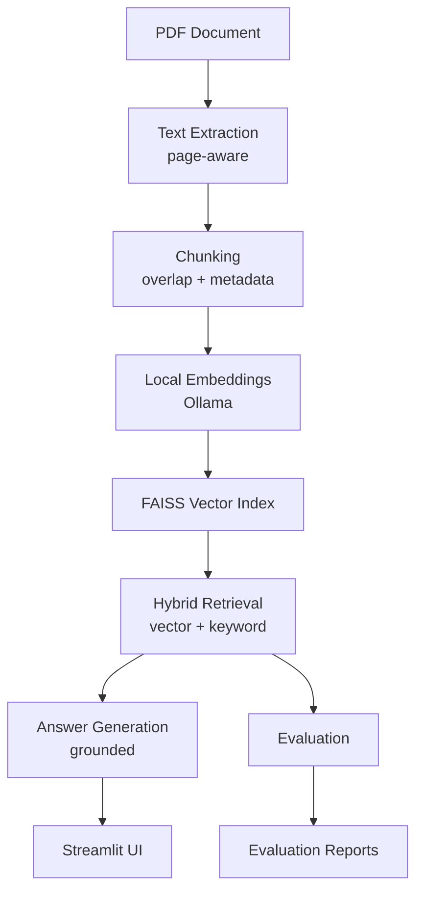

# 📘 Single-PDF RAG System (Evaluated & Persistent)

A **production-style Retrieval-Augmented Generation (RAG) system** that enables users to ask questions over a single PDF document with **measurable retrieval quality**, **persistent caching**, and an interactive **Streamlit UI**.

This repository is intentionally engineered beyond a demo: retrieval is evaluated, artifacts are cached, and system behavior is explainable and reproducible.

---

## ✨ Highlights

- 📄 **Single-PDF ingestion** (handbooks, policies, manuals)
- ✂️ **Page-aware chunking with overlap**
- 🧠 **Local embeddings** via Ollama (`nomic-embed-text`)
- 🔍 **Hybrid retrieval** (FAISS vector search + keyword fallback)
- 📊 **Formal evaluation** using Recall@K and MRR
- 💾 **Persistent cache** (embeddings + FAISS index)
- 🖥️ **Streamlit UI** with citations and chat history
- 🛑 **Grounded generation** (the prompt restricts answers to the retrieved context and asks for a fixed refusal when the context does not support an answer; this is prompt-level only and is not yet scored or verified)
- ✅ **Offline unit tests** (pytest, no Ollama needed)

---

## 🧠 Why this project

Most RAG examples:
- skip evaluation
- rebuild embeddings on every run
- rely on opaque APIs
- cannot explain retrieval failures

This project focuses on:
- **measurable retrieval quality**
- **repeatability**
- **debuggability**
- **real-world system design**

---

## 🏗️ System Architecture



### Project Structure

```
.
├── extract_pdf_text.py      # PDF → page-level text
├── chunk_strategy.py        # Chunking + normalization
├── embedding_strategy.py    # Local embeddings via Ollama
├── index_strategy.py        # FAISS index + hybrid retrieval
├── generation_strategy.py   # Grounded answer generation
├── persistence.py           # Embedding + FAISS caching primitives
├── artifacts.py             # load_or_build_artifacts: cache-or-build, shared by app and eval
├── ollama_check.py          # Friendly check that Ollama and both models are available
├── main.py                  # Streamlit app entry point
│
├── eval/
│   ├── eval_runner.py       # Retrieval eval (Recall@K, MRR), hand-written pipeline
│   ├── compare.py           # Three-way comparison (retrieval, refusal, latency)
│   ├── COMPARISON.md        # Results and honest analysis of that comparison
│   ├── eval_dataset.jsonl   # Ground-truth evaluation set (10 questions)
│   ├── eval_dataset_extended.jsonl  # 26 questions: 16 answerable, 10 negative
│   ├── eval_results.jsonl   # Per-question results (latest run)
│   ├── eval_summary.json    # Aggregate metrics (latest run)
│   ├── baseline_results.jsonl  # Recorded baseline, per question
│   └── baseline_summary.json   # Recorded baseline, aggregate
│
├── lc_rag/                  # LangChain and LangGraph versions (see "Two versions" below)
│   ├── ingest.py            # PyMuPDFLoader, splitter, FAISS store, cache
│   ├── retriever.py         # BM25 + FAISS EnsembleRetriever
│   ├── chain.py             # LangChain pipeline (LCRag)
│   ├── graph.py             # LangGraph pipeline (GraphRag)
│   ├── cli.py               # python -m lc_rag.cli
│   └── app_lc.py            # separate Streamlit page
│
├── tests/                   # pytest suite (mocked, no Ollama needed)
├── pytest.ini               # test path and import settings
├── cache/                   # Persistent embeddings + FAISS (git-ignored)
├── LEARNING_NOTES.md        # State, nodes and conditional edges in plain language
├── requirements.txt
├── requirements-lc.txt      # adds LangChain, LangGraph, BM25 (pinned)
└── requirements-dev.txt     # adds pytest
```

---

## 📊 Evaluation Methodology

Evaluation is retrieval-first, which is critical for RAG systems.

**Implemented metrics:**

- **Recall@K**: whether at least one correct source page is retrieved in the top-K results (a hit rate).
- **MRR (Mean Reciprocal Rank)**: how highly the first correct page is ranked, at page level.

Ground truth is defined manually in `eval/eval_dataset.jsonl` using:
- Fixed questions
- Known correct page numbers
- Negative (refusal) cases

`eval/eval_runner.py` measures retrieval only. It does not call the generation model, and negative
cases are excluded from the Recall@K and MRR averages. Refusal correctness and latency are scored
by `eval/compare.py` (see "Two versions" below).

Page numbers in the dataset are 1-based PDF page indexes, which is what the pipeline reports. The
handbook also prints its own page numbers, and they run one lower (the pets policy is on PDF page 19,
printed page 18). The repository root also holds `evaluation_questions.docx`, a human-readable copy of
the original 10 questions that is not used by any code. It lists Q1 and Q2 with the printed page (18)
while the dataset uses the PDF page (19), so treat the `.jsonl` files as the source of truth.

This ensures evaluation is objective, reproducible, and actionable for debugging.

---

## 💾 Persistence Design

To avoid re-embedding on every run, the system caches:
- Embedded chunks (JSONL)
- FAISS index (binary)

Cache keys are derived from:
- PDF content hash
- Chunking parameters
- Embedding model name

The Streamlit app and the eval both go through `artifacts.load_or_build_artifacts`, so they share one cache and one key. The chunk size and overlap are defined once in `chunk_strategy.py`, and the cache key uses those same values.

This guarantees correctness while providing a significant speed-up on subsequent runs.

---

## 🖥️ Streamlit UI

The Streamlit interface provides:
- Interactive Q&A
- Answer citations (page + chunk)
- An expandable list of citations (page and chunk id) under each answer
- Session-based chat history

Run the app with:

```bash
streamlit run main.py
```

---

## ⚙️ Setup & Usage

### 1. Install dependencies

```bash
python -m venv .venv
source .venv/bin/activate
pip install -r requirements.txt
```

### 2. Start Ollama and pull both models

```bash
ollama serve
ollama pull nomic-embed-text
ollama pull llama3.1:8b
```

The app and the eval check this at startup and print a clear message if Ollama is not running or a model is missing.

### 3. Point the app at a PDF

`PDF_PATH` is required. There is no default path.

```bash
export PDF_PATH=/path/to/your/document.pdf
```

### 4. Run the app

```bash
streamlit run main.py
```

- First run builds the cache.
- Subsequent runs load from the cache.

---

## 🧪 Run Evaluation

Run from the repository root, with `PDF_PATH` set to the same PDF the dataset was written for:

```bash
PDF_PATH=/path/to/your/document.pdf python -m eval.eval_runner
```

Outputs:
- `eval/eval_results.jsonl`
- `eval/eval_summary.json`

The eval uses the same cache as the app, so repeat runs do not re-embed.
`eval/baseline_results.jsonl` and `eval/baseline_summary.json` hold the recorded baseline to compare against.

## 🔀 Two versions: hand-written vs framework

The repository holds two implementations of the same pipeline so they can be compared.

| | Hand-written (baseline) | Framework (`lc_rag/`) |
|---|---|---|
| Where | the modules in the repo root | `lc_rag/` |
| Retrieval | keyword-first merge of substring-count hits and FAISS hits | BM25 + FAISS fused by LangChain's `EnsembleRetriever` |
| Orchestration | retrieve, then generate | LangChain chain, or a LangGraph state machine with context grading, query rewriting and answer verification |
| UI | `streamlit run main.py` | `streamlit run lc_rag/app_lc.py` |
| CLI | none (eval only) | `python -m lc_rag.cli` |

The hand-written modules are unchanged and remain the baseline.

### Run the framework versions

```bash
pip install -r requirements-lc.txt
export PDF_PATH=/path/to/your/document.pdf

# LangChain chain
python -m lc_rag.cli "Are pets allowed in the residence halls?"

# LangGraph (prints the path the question took through the graph)
python -m lc_rag.cli --mode graph "Are pets allowed in the residence halls?"

# Streamlit page with a switch between the two
streamlit run lc_rag/app_lc.py
```

`LEARNING_NOTES.md` explains State, nodes and conditional edges using this graph.

### Comparison results

Run with `PDF_PATH=... python -m eval.compare` on 26 questions (16 answerable, 10 negative) from
`eval/eval_dataset_extended.jsonl`, using `llama3.1:8b` through Ollama. One run, one document.

| Metric | Hand-written | LangChain | LangGraph |
|---|---|---|---|
| Recall@K (n=16 answerable) | 1.000 | 1.000 | 1.000 |
| MRR | 0.859 | 0.969 | 0.969 |
| Refusal correctness on negatives (n=10) | 10/10 | 10/10 | 10/10 |
| Over-refusal on answerables (n=16) | 0/16 | 0/16 | 0/16 |
| Mean latency per question (s) | 8.6 | 9.4 | 23.3 |

Short version: the framework versions ranked the right page higher on 3 of 16 questions (MRR 0.969 vs
0.859). All three refused correctly every time, so the graph's grading and verification did not change
any answer, and LangGraph cost about 2.5 times the latency of the plain chain. The samples are small,
so none of these differences should be called significant. See [`eval/COMPARISON.md`](eval/COMPARISON.md)
for the full analysis, the places the LangChain version cannot reproduce the baseline exactly, and the
limits of the comparison.

## ✅ Run Tests

```bash
pip install -r requirements-dev.txt
python -m pytest
```

The tests mock all HTTP calls and do not need Ollama.

---

## 🔮 Future Work

- Multi-PDF ingestion
- Reranking (query rewriting exists in the LangGraph version; see `eval/COMPARISON.md` for what it did and did not help)
- Adversarial negative questions and an automatic answer-correctness metric
- Stop the graph's rewrite loop when a rewrite repeats the previous query
- Dockerization
- Extended evaluation dashboards

---

## 📜 License

Intended license: MIT. A `LICENSE` file has not been added to the repository yet.
