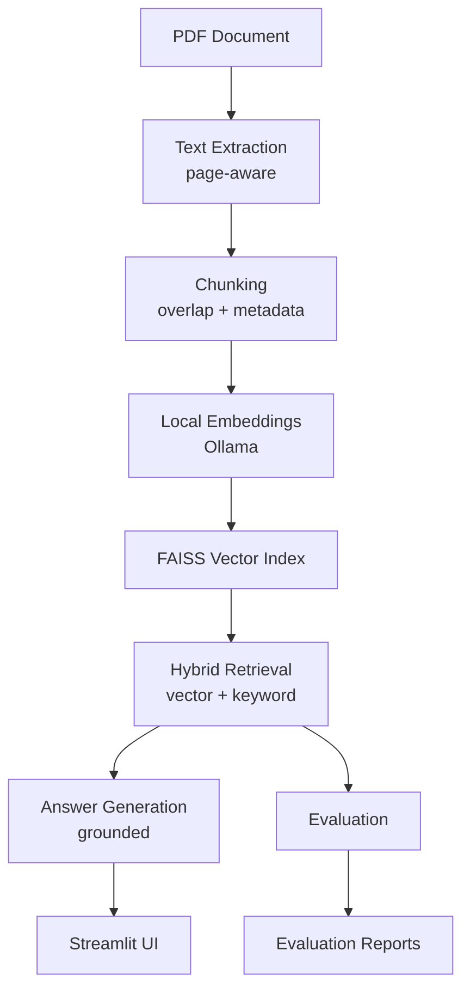

# 📘 Single-PDF RAG System (Evaluated & Persistent)

A **production-style Retrieval-Augmented Generation (RAG) system** that enables users to ask questions over a single PDF document with **measurable retrieval quality**, **persistent caching**, and an interactive **Streamlit UI**.

This repository is intentionally engineered beyond a demo: retrieval is evaluated, artifacts are cached, and system behavior is explainable and reproducible.

---

## ✨ Highlights

- 📄 **Single-PDF ingestion** (handbooks, policies, manuals)
- ✂️ **Page-aware chunking with overlap**
- 🧠 **Local embeddings** via Ollama (`nomic-embed-text`)
- 🔍 **Hybrid retrieval** (FAISS vector search + keyword fallback)
- 📊 **Formal evaluation** using Recall@K and MRR
- 💾 **Persistent cache** (embeddings + FAISS index)
- 🖥️ **Streamlit UI** with citations and chat history
- 🛑 **Grounded generation** (the prompt restricts answers to the retrieved context and asks for a fixed refusal when the context does not support an answer; this is prompt-level only and is not yet scored or verified)
- ✅ **Offline unit tests** (pytest, no Ollama needed)

---

## 🧠 Why this project

Most RAG examples:
- skip evaluation
- rebuild embeddings on every run
- rely on opaque APIs
- cannot explain retrieval failures

This project focuses on:
- **measurable retrieval quality**
- **repeatability**
- **debuggability**
- **real-world system design**

---

## 🏗️ System Architecture



### Project Structure

```
.
├── extract_pdf_text.py      # PDF → page-level text
├── chunk_strategy.py        # Chunking + normalization
├── embedding_strategy.py    # Local embeddings via Ollama
├── index_strategy.py        # FAISS index + hybrid retrieval
├── generation_strategy.py   # Grounded answer generation
├── persistence.py           # Embedding + FAISS caching primitives
├── artifacts.py             # load_or_build_artifacts: cache-or-build, shared by app and eval
├── ollama_check.py          # Friendly check that Ollama and both models are available
├── main.py                  # Streamlit app entry point
│
├── eval/
│   ├── eval_runner.py       # Retrieval eval (Recall@K, MRR)
│   ├── eval_dataset.jsonl   # Ground-truth evaluation set
│   ├── eval_results.jsonl   # Per-question results (latest run)
│   ├── eval_summary.json    # Aggregate metrics (latest run)
│   ├── baseline_results.jsonl  # Recorded baseline, per question
│   └── baseline_summary.json   # Recorded baseline, aggregate
│
├── tests/                   # pytest suite (mocked, no Ollama needed)
├── cache/                   # Persistent embeddings + FAISS (git-ignored)
├── requirements.txt
└── requirements-dev.txt     # adds pytest
```

---

## 📊 Evaluation Methodology

Evaluation is retrieval-first, which is critical for RAG systems.

**Implemented metrics:**

- **Recall@K**: whether at least one correct source page is retrieved in the top-K results (a hit rate).
- **MRR (Mean Reciprocal Rank)**: how highly the first correct page is ranked, at page level.

Ground truth is defined manually in `eval/eval_dataset.jsonl` using:
- Fixed questions
- Known correct page numbers
- Negative (refusal) cases

The eval measures retrieval only. It does not call the generation model, and negative
cases are excluded from the Recall@K and MRR averages. Refusal correctness is not
scored yet.

This ensures evaluation is objective, reproducible, and actionable for debugging.

---

## 💾 Persistence Design

To avoid re-embedding on every run, the system caches:
- Embedded chunks (JSONL)
- FAISS index (binary)

Cache keys are derived from:
- PDF content hash
- Chunking parameters
- Embedding model name

The Streamlit app and the eval both go through `artifacts.load_or_build_artifacts`, so they share one cache and one key. The chunk size and overlap are defined once in `chunk_strategy.py`, and the cache key uses those same values.

This guarantees correctness while providing a significant speed-up on subsequent runs.

---

## 🖥️ Streamlit UI

The Streamlit interface provides:
- Interactive Q&A
- Answer citations (page + chunk)
- An expandable list of citations (page and chunk id) under each answer
- Session-based chat history

Run the app with:

```bash
streamlit run main.py
```

---

## ⚙️ Setup & Usage

### 1. Install dependencies

```bash
python -m venv .venv
source .venv/bin/activate
pip install -r requirements.txt
```

### 2. Start Ollama and pull both models

```bash
ollama serve
ollama pull nomic-embed-text
ollama pull llama3.1:8b
```

The app and the eval check this at startup and print a clear message if Ollama is not running or a model is missing.

### 3. Point the app at a PDF

`PDF_PATH` is required. There is no default path.

```bash
export PDF_PATH=/path/to/your/document.pdf
```

### 4. Run the app

```bash
streamlit run main.py
```

- First run builds the cache.
- Subsequent runs load from the cache.

---

## 🧪 Run Evaluation

Run from the repository root, with `PDF_PATH` set to the same PDF the dataset was written for:

```bash
PDF_PATH=/path/to/your/document.pdf python -m eval.eval_runner
```

Outputs:
- `eval/eval_results.jsonl`
- `eval/eval_summary.json`

The eval uses the same cache as the app, so repeat runs do not re-embed.
`eval/baseline_results.jsonl` and `eval/baseline_summary.json` hold the recorded baseline to compare against.

## ✅ Run Tests

```bash
pip install -r requirements-dev.txt
python -m pytest
```

The tests mock all HTTP calls and do not need Ollama.

---

## 🔮 Future Work

- Multi-PDF ingestion
- Query rewriting and reranking
- Automated refusal correctness scoring
- Dockerization
- Extended evaluation dashboards

---

## 📜 License

Intended license: MIT. A `LICENSE` file has not been added to the repository yet.
